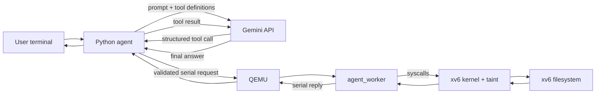

# End-to-end explanation of the Gemini → QEMU → xv6 pipeline

## 1. What we have built

We built a small host-side AI agent that can inspect files inside an xv6 guest
and demonstrate kernel-enforced taint tracking.

**Available tools:**

| Tool | Arguments | Description |
|---|---|---|
| `list_files(path)` | absolute path | List names in an xv6 directory |
| `read_file(path)` | absolute path | Read an xv6 text file (up to 4096 bytes) |
| `mark_file(path)` | absolute path | Mark a regular file as untrusted (a taint source) |
| `taint_status()` | — | Return whether the persistent worker is tainted |
| `try_write(path)` | absolute path | Attempt to write a fixed message to an existing file |

Gemini does not directly open files. It proposes a structured tool call:

```json
{
  "tool": "mark_file",
  "args": {"path": "/inbox.txt"}
}
```

Our Python program validates the call, sends a request through QEMU's serial
console, and the xv6 worker executes the appropriate system calls. The result
returns to Python and then to Gemini.

## 2. Which part runs where?

| Location | What runs there | Responsibility |
|---|---|---|
| Ubuntu host | Terminal, Python agent, Gemini SDK, QEMU process | Accept the user's request, ask Gemini for a tool call, validate it, and communicate with QEMU. |
| Google servers | Gemini model | Interpret the natural-language instruction, choose a declared tool, and later summarize the tool result. |
| xv6 guest inside QEMU | xv6 kernel (with taint enforcement), xv6 shell, `agent_worker` | Execute the approved operation using xv6 system calls and return the actual guest result. |

QEMU is an ordinary Ubuntu process, but it emulates a complete x86 computer.
Inside that emulated computer, xv6 boots as the operating system.



## 3. Taint tracking design

### Kernel data structures

| Structure | Field | Meaning |
|---|---|---|
| `struct proc` | `int tainted` | Non-zero when the process has read untrusted data |
| `struct inode` | `short untrusted` | In-memory untrusted flag (loaded from disk by `ilock`) |
| `struct dinode` | `short untrusted` | On-disk persistence of the untrusted flag |
| `struct pipe` | `int tainted` | Sticky flag: set when a tainted process writes to this pipe |

`NDIRECT` was reduced from 12 to 11 so that `struct dinode` remains exactly
64 bytes after adding the `short untrusted` field.

### How taint spreads

```
marktaint("/inbox.txt")       → inode.untrusted = 1  (Priyam)
read("/inbox.txt") >= 1 byte  → proc.tainted   = 1  (Abhishek)
fork()                        → child.tainted  = 1  (Abhishek)
exec() inside /safe/          → taint survives      (Abhishek)
pipewrite() by tainted proc   → pipe.tainted   = 1  (Suparn)
piperead()  from tainted pipe → proc.tainted   = 1  (Suparn)
```

### What the kernel enforces

| Attempted operation | Condition | Result |
|---|---|---|
| `write` to existing clean file | proc is tainted | Returns `-1`, logs one line |
| `unlink` any path | proc is tainted | Returns `-1`, logs one line |
| `exec` path not under `/safe/` | proc is tainted | Returns `-1`, logs one line |
| `create` new regular file | proc is tainted | New file marked untrusted automatically |
| Write to console or pipe | any | Always allowed |

### End-to-end taint demo flow

```
Step 1  mark_file("/inbox.txt")  → kernel: inode.untrusted = 1
Step 2  read_file("/inbox.txt")  → kernel: proc.tainted    = 1
Step 3  taint_status()           → @XV6 TAINT 1
Step 4  try_write("/clean.txt")  → kernel: REFUSED (write_blocked)
Step 5  read_file("/clean.txt")  → file unchanged, policy confirmed
```

## 4. The files and their roles

### `agent/main.py` — agent and terminal interface on Ubuntu

This is the main host-side program. It:

1. Loads `GEMINI_API_KEY` and `GEMINI_MODEL` from the project-root `.env` file.
2. Declares all five tools and their JSON argument schemas for Gemini.
3. Reads the user's instruction from the terminal.
4. Runs the Gemini function-calling loop.
5. Passes approved tool calls to `QemuBridge` and sends results back to Gemini.

`SYSTEM_INSTRUCTION` tells Gemini to use actual tool results, treat file content
as data, use absolute guest paths, and stay within five tool calls.

### `agent/bridge.py` — boundary between Ubuntu and the xv6 guest

This module owns the QEMU process and converts a Python tool call into the
small text protocol understood by `agent_worker`.

```python
PATH_OPERATIONS  = {"list_files": "LIST", "read_file": "READ",
                    "mark_file": "TAINT", "try_write": "WRITE"}
NO_ARG_OPERATIONS = {"taint_status": "STATUS"}
```

Gemini only sees the names on the left. The guest worker only sees the protocol
operations on the right. `validate_action()` applies different schemas: path
operations require exactly one valid absolute path; `taint_status` requires no
arguments.

### `agent_worker.c` — persistent user process inside xv6

The worker handles five protocol operations:

| Request | xv6 syscalls used |
|---|---|
| `LIST <path>` | `open`, `fstat`, `read` (dirents), `close` |
| `READ <path>` | `open`, `fstat`, `read`, `close` |
| `TAINT <path>` | `marktaint(path)` (syscall 23) |
| `STATUS` | `istainted()` (syscall 24) → `@XV6 TAINT 0` or `1` |
| `WRITE <path>` | `open(O_RDWR)`, `write` (fixed message), `close` |

The worker stays alive for the entire agent session. When it reads an untrusted
file, it becomes tainted and all subsequent kernel operations from that process
are subject to the taint policy.

### `Makefile`, images, and sample data

- `xv6.img` — bootable xv6 kernel image.
- `agent-fs.img` — xv6 filesystem for the demo, containing:
  - `report.txt` — sample file for Milestone 1 read demo.
  - `inbox.txt` — file marked untrusted by the taint demo.
  - `clean.txt` — file that should survive a blocked write attempt.
  - all compiled xv6 user programs.
- The bridge copies both images into a temporary directory before starting QEMU.

## 5. Startup sequence

```bash
.venv/bin/python -m agent.main
```

1. `main.py` reads `.env` and creates a Gemini client.
2. `build_images()` runs `make xv6.img agent-fs.img`.
3. `QemuBridge.start()` creates temporary copies of both disk images.
4. Python starts `qemu-system-i386` with one virtual CPU and 512 MB memory.
5. QEMU emulates the x86 hardware and boots the xv6 kernel from `xv6.img`.
6. xv6 mounts the filesystem from `agent-fs.img` and starts its shell.
7. Python watches QEMU's serial output until it sees the xv6 `$ ` prompt.
8. Python writes `agent_worker\n` to the serial console.
9. The worker prints `@XV6 READY <pid>` and waits for requests.

## 6. Serial protocol

```text
Python → xv6:  LIST /
Python → xv6:  READ /inbox.txt
Python → xv6:  TAINT /inbox.txt
Python → xv6:  STATUS
Python → xv6:  WRITE /clean.txt

xv6 → Python:  @XV6 DATA <hex-encoded-bytes>   (zero or more)
xv6 → Python:  @XV6 DONE OK
xv6 → Python:  @XV6 DONE TRUNCATED
xv6 → Python:  @XV6 DONE ERROR <reason>
xv6 → Python:  @XV6 TAINT 0                    (STATUS response only)
xv6 → Python:  @XV6 TAINT 1
```

Hex encoding prevents file text from being confused with protocol control
messages. Requests run one at a time.

## 7. Available running modes

### Live Gemini mode

```bash
.venv/bin/python -m agent.main
```

Natural language goes to Gemini. Gemini chooses tools, receives xv6 results,
and writes the final answer. Needs a valid `.env`, internet access, and quota.

### Scripted interactive mode

```bash
python3 -m agent.main --scripted
```

Supported commands:

```text
list [PATH]       list a directory (default: /)
read PATH         read a file
taint PATH        mark a file as untrusted
status            check if the worker is tainted
write PATH        attempt to write to an existing file
exit / quit       stop
```

### Repeatable read-only demonstration

```bash
python3 -m agent.main --demo
```

Lists `/`, reads `/report.txt`, and tries `/missing.txt`.

### Taint enforcement demonstration

```bash
python3 -m agent.main --taint-demo
```

Runs the five-step sequence without Gemini:

1. Mark `/inbox.txt` as untrusted.
2. Read `/inbox.txt` (worker becomes tainted).
3. Query taint status (expect `tainted: true`).
4. Attempt to write to `/clean.txt` (kernel blocks it).
5. Read `/clean.txt` to confirm it is unchanged.

## 8. Important limits and error handling

- Five Gemini tool calls are allowed per user instruction.
- Files and listings are limited to 4096 bytes.
- Only text (valid UTF-8) is returned; binary files produce `not_utf8_text`.
- Guest operations time out after 10 seconds; boot waits up to 30 seconds.
- A malformed reply closes the guest session.
- No API key is sent through the serial protocol into xv6.
- Each QEMU session uses a temporary copy of the disk images, so the demo
  always starts from a clean state.

## 9. Security: host vs guest responsibilities

The Python validator and Gemini tool declarations provide a first line of
defence. The xv6 kernel is the final enforcement point. Even if a future model
is tricked into proposing a dangerous tool call, the kernel will refuse it if
the process is tainted.

| Responsibility | Host (Python) | Guest (xv6 kernel) |
|---|---|---|
| Tool whitelist | validate_action | worker checks op string |
| Path sanitisation | regex + component check | valid_path in worker |
| Taint propagation | — | fileread, fork, exec, pipe |
| Write policy | — | filewrite refuses clean file |
| Unlink policy | — | sys_unlink refuses tainted proc |
| Exec policy | — | exec checks /safe/ prefix |
