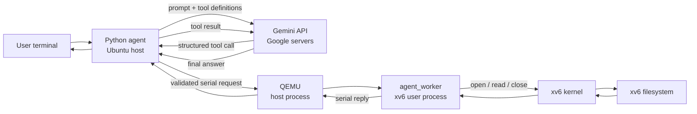

# End-to-end explanation of the Gemini → QEMU → xv6 pipeline

## 1. What we have built

We built a small host-side AI agent that can inspect files inside an xv6 guest.
You type a normal-language instruction such as:

```text
Read /report.txt and summarize it.
```

Gemini does not directly open the file. It proposes a structured tool call:

```json
{
  "tool": "read_file",
  "args": {"path": "/report.txt"}
}
```

Our Python program validates the call, sends a simple request through QEMU's
serial console, and an xv6 user program reads the file using existing xv6
system calls. The result travels back to Python and then to Gemini, which writes
the final answer.

This milestone is read-only. It supports:

- `list_files(path)` — list the names in an xv6 directory.
- `read_file(path)` — read an xv6 text file, up to 4096 bytes.

We have not implemented taint tracking or kernel protection yet. Those are the
next project stage. The current pipeline gives us the path through which we can
later demonstrate those kernel policies.

## 2. Which part runs where?

There are two separate computers from the software's point of view:

| Location | What runs there | Responsibility |
|---|---|---|
| Ubuntu host | Terminal, Python agent, Gemini SDK, QEMU process | Accept the user's request, ask Gemini for a tool call, validate it, and communicate with QEMU. |
| Google servers | Gemini model | Interpret the natural-language instruction, choose a declared tool, and later summarize the tool result. |
| xv6 guest inside QEMU | xv6 kernel, xv6 shell, `agent_worker` | Execute the approved operation using xv6 system calls and return the actual guest result. |

QEMU is an ordinary Ubuntu process, but it emulates a complete x86 computer.
Inside that emulated computer, xv6 boots as the operating system. xv6 has its
own kernel, processes, filesystem, and paths. Therefore `/report.txt` means a
file in the xv6 filesystem, not `/report.txt` on Ubuntu.



## 3. The files and their roles

### `agent/main.py` — agent and terminal interface on Ubuntu

This is the main host-side program. It performs five jobs:

1. Loads `GEMINI_API_KEY` and `GEMINI_MODEL` from the project-root `.env` file.
2. Declares the two tools and their JSON argument schemas for Gemini.
3. Reads the user's instruction from the terminal.
4. Runs the Gemini function-calling loop.
5. Passes approved tool calls to `QemuBridge` and sends results back to Gemini.

The declarations in `TOOLS` tell Gemini that the only available
actions are `list_files` and `read_file`. A tool declaration describes an
action; it does not execute that action.

`SYSTEM_INSTRUCTION` tells Gemini to use actual tool results, treat file content
as data, use absolute guest paths, and stay within five tool calls.

### `agent/bridge.py` — boundary between Ubuntu and the xv6 guest

This module owns the QEMU process and converts a Python tool call into the
small text protocol understood by `agent_worker`.

It:

- builds `xv6.img` and `agent-fs.img`;
- starts QEMU without a graphical window;
- waits for the xv6 shell prompt;
- starts `agent_worker` inside xv6;
- validates every tool name and path;
- writes requests to QEMU's standard input;
- reads replies from QEMU's standard output;
- checks replies, errors, timeouts, and output limits; and
- stops QEMU and removes its temporary disk copies when the session ends.

The bridge contains the mapping:

```python
OPERATIONS = {
    "list_files": "LIST",
    "read_file": "READ",
}
```

Gemini only sees the names on the left. The guest worker only sees the protocol
operations on the right.

### `agent_worker.c` — persistent user process inside xv6

The worker is compiled as an xv6 user program and placed in the guest
filesystem as `agent_worker`. It starts inside xv6, prints a ready message, and
then waits for line-based requests on standard input.

For a read request it calls:

```text
open(path, O_RDONLY) → fstat(fd, ...) → read(fd, ...) → close(fd)
```

For a directory listing it opens the directory and reads its `struct dirent`
entries. These are normal existing xv6 system calls. We did not add a new
`read_file` system call to the kernel.

Keeping one worker alive for the entire agent session matters for the later
project. When reading an untrusted file eventually taints this process, later
operations will still be performed by the same process and the kernel can
continue enforcing restrictions on it.

### `Makefile`, images, and sample data

The Makefile adds `_agent_worker` to `UPROGS`, so `mkfs` packages the worker into
the xv6 filesystem. It also defines a separate `agent-fs.img` containing the
sample `report.txt`.

- `xv6.img` contains the bootable xv6 kernel image.
- `agent-fs.img` contains the xv6 filesystem used by this demonstration.
- `report.txt` on the host is copied into `agent-fs.img` at build time and
  appears as `/report.txt` inside xv6.

The bridge copies both images into a temporary directory before starting QEMU.
This avoids modifying the original images and avoids conflicts with another
QEMU instance that may already be open.

## 4. Startup sequence

Run the live agent from the repository root:

```bash
.venv/bin/python -m agent.main
```

The following startup steps happen:

1. `main.py` reads `.env` and creates a Gemini client.
2. `build_images()` runs `make xv6.img agent-fs.img`.
3. `QemuBridge.start()` creates temporary copies of both disk images.
4. Python starts `qemu-system-i386` with one virtual CPU and 512 MB memory.
5. QEMU emulates the x86 hardware and boots the xv6 kernel from `xv6.img`.
6. xv6 mounts the filesystem from `agent-fs.img` and starts its shell.
7. Python watches QEMU's serial output until it sees the xv6 `$ ` prompt.
8. Python writes `agent_worker\n` to the serial console, just as if someone
   typed the command at the xv6 shell.
9. The xv6 shell creates the `agent_worker` process.
10. The worker prints `@XV6 READY <pid>` and waits for requests.

At this point the host agent and guest worker are connected and ready.

## 5. One complete `read_file` request

Suppose the user enters:

```text
Read /report.txt and summarize it.
```

### Step 1: Python sends the prompt and tool descriptions to Gemini

`GeminiAgent.run()` creates a Gemini request containing:

- the user's instruction;
- the system instruction;
- the `list_files` and `read_file` declarations; and
- the rule that our code, rather than the SDK, executes function calls.

Gemini receives descriptions of tools, not direct access to Python, QEMU, the
host shell, or xv6.

### Step 2: Gemini proposes a structured tool call

Gemini may return a function call equivalent to:

```json
{
  "name": "read_file",
  "args": {"path": "/report.txt"}
}
```

This is still only data. Nothing has been executed yet.

### Step 3: Python validates and dispatches the call

`execute_tool()` calls `bridge.execute()`. `validate_action()` checks that:

- the tool is exactly `read_file` or `list_files`;
- the only argument is `path`;
- the path is absolute;
- its length and characters are permitted;
- no path component is empty, `.` or `..`; and
- each component fits xv6's 14-character filename limit.

Python never converts Gemini text into a host shell command. After validation,
the bridge maps `read_file` to `READ` and creates:

```text
READ /report.txt
```

### Step 4: The request reaches xv6 through QEMU serial I/O

QEMU was started with `-serial stdio`. This connects the emulated machine's
serial console to the Python QEMU process's standard input and output:

```text
Python process stdin pipe  →  QEMU serial input  →  xv6 console input
xv6 console output         →  QEMU serial output → Python process stdout pipe
```

The worker is already reading file descriptor `0`, so it receives the request
line. QEMU does not understand the tool or read the file; it only carries bytes
between Python and the emulated machine.

### Step 5: The worker invokes xv6 system calls

`agent_worker` parses the request again, validates the path again, and calls
`open`, `fstat`, `read`, and `close`.

These C library stubs enter the xv6 kernel through the normal system-call path.
The kernel checks the descriptor and inode, reads filesystem blocks from the
guest disk, and copies the data back into the worker's user-space buffer.

This distinction is central:

| Level | Example | Meaning |
|---|---|---|
| Gemini tool call | `read_file({"path":"/report.txt"})` | A structured request proposed by the model. |
| Bridge protocol | `READ /report.txt` | Bytes sent from host Python to the persistent guest worker. |
| xv6 system calls | `open`, `fstat`, `read`, `close` | Controlled entries from the xv6 user program into the xv6 kernel. |

### Step 6: The worker returns a framed response

The worker sends file bytes in hexadecimal DATA messages:

```text
@XV6 DATA 546865207365727665722068616e646c6564...
@XV6 DONE OK
```

There may be several DATA lines. Hex encoding prevents a line inside a file
from looking like a protocol control message. Requests run one at a time, so
the next completion belongs to the current request.

Possible completions include:

```text
@XV6 DONE OK
@XV6 DONE TRUNCATED
@XV6 DONE ERROR open_failed
```

### Step 7: Python reconstructs the tool result

The bridge reads complete lines even if QEMU returns output in smaller chunks.
It verifies the reply format, decodes the hexadecimal bytes as UTF-8, and returns
a Python dictionary such as:

```json
{
  "ok": true,
  "path": "/report.txt",
  "content": "The server handled 100 requests.\nFive requests failed.\nAverage response time was 20 ms.\n",
  "truncated": false
}
```

### Step 8: The result goes back to Gemini

`main.py` sends that dictionary as the response to Gemini's original function
call. Gemini now has actual file contents and can produce a grounded answer,
for example:

```text
The server handled 100 requests, with five failures (5%), and had an average
response time of 20 ms.
```

The answer is printed in the Ubuntu terminal. The complete round trip is now
finished.

## 6. How commands are issued

The word “command” can mean three things here:

1. **User instruction:** natural language typed into the Ubuntu terminal.
2. **Tool call:** structured `list_files` or `read_file` data proposed by Gemini.
3. **Guest protocol request:** a validated `LIST` or `READ` line sent to the
   already-running xv6 worker.

The model cannot issue arbitrary xv6 or Ubuntu shell commands. It can only
request the two declared tools. The Python validator rejects unknown tools and
malformed paths before anything reaches QEMU. The guest worker also supports
only `LIST` and `READ`.

## 7. Available running modes

### Live Gemini mode

```bash
.venv/bin/python -m agent.main
```

Natural language goes to Gemini. Gemini chooses tools, receives xv6 results,
and writes the final answer. This mode needs a valid `.env`, internet access,
and Gemini quota.

### Scripted interactive mode

```bash
python3 -m agent.main --scripted
```

Use commands such as `list /` and `read /report.txt`. This bypasses Gemini but
uses the same validator, bridge, QEMU instance, worker, xv6 system calls, and
response protocol.

### Repeatable demonstration mode

```bash
python3 -m agent.main --demo
```

This automatically lists `/`, reads `/report.txt`, and tries `/missing.txt`.
It proves that the real Python → QEMU → xv6 → Python pipeline works even when a
Gemini key or network connection is unavailable. It must be described as a
scripted demonstration because no model is involved.

## 8. Important limits and error handling

- Only two read-only tools are accepted.
- At most five Gemini tool calls are allowed per user instruction.
- A returned file or listing is limited to 4096 bytes.
- Only text is supported; control characters and invalid UTF-8 are rejected.
- Guest operations time out after 10 seconds; boot waits up to 30 seconds.
- Missing files return `open_failed`; the agent does not invent contents.
- A malformed reply or transport failure closes the guest session because the
  serial stream can no longer be trusted to be synchronized.
- The Gemini SDK uses the API key to authenticate with Google's API. The bridge
  removes Gemini key variables before starting QEMU, and no key is sent through
  the serial protocol into xv6.

## 9. What is still to be implemented

This milestone proves that an agent can request an action, that the action can
reach an xv6 process, and that the actual result can return to the model.

The security project will later extend xv6 so that:

- a file can be marked untrusted;
- reading it taints the persistent worker process;
- taint propagates through fork, exec, pipes, and written files; and
- the xv6 kernel refuses dangerous operations by tainted processes.

The model and Python validator help keep requests controlled, but the kernel is
the final enforcement point. Even if a future model is tricked into proposing a
dangerous action, the goal is for the xv6 kernel to reject it.

## 10. Short presentation explanation

You can explain the demo as follows:

> The Python agent runs on Ubuntu, while xv6 runs as a guest operating system
> inside QEMU. Gemini only chooses between two structured tools. Python validates
> the chosen tool and sends a small request through QEMU's serial console to a
> persistent xv6 user program. That program uses ordinary xv6 system calls to
> read the guest filesystem and sends the result back. Python gives the real
> result to Gemini, and Gemini prepares the final answer. The current milestone
> proves this end-to-end pipeline; kernel taint enforcement is the next stage.
